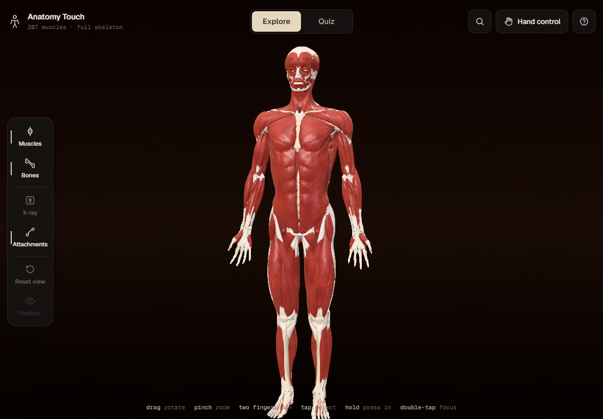
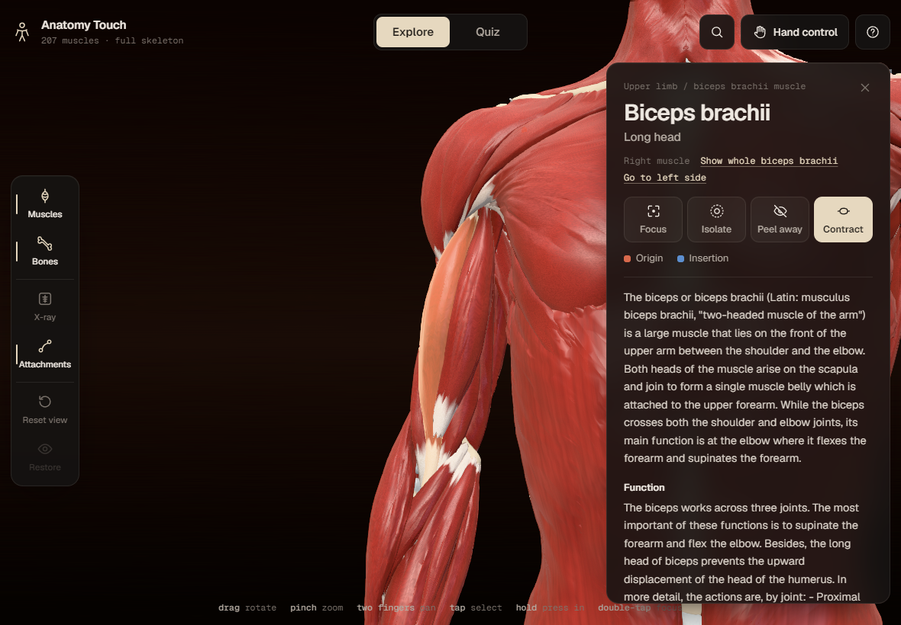
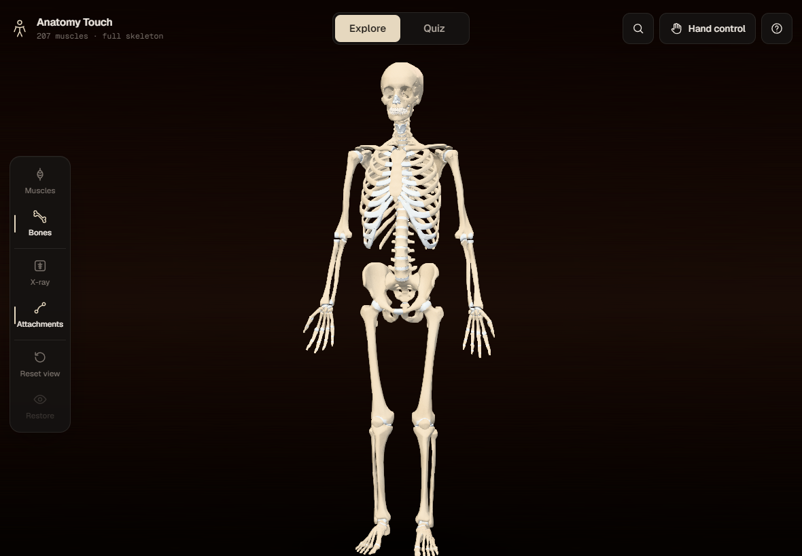
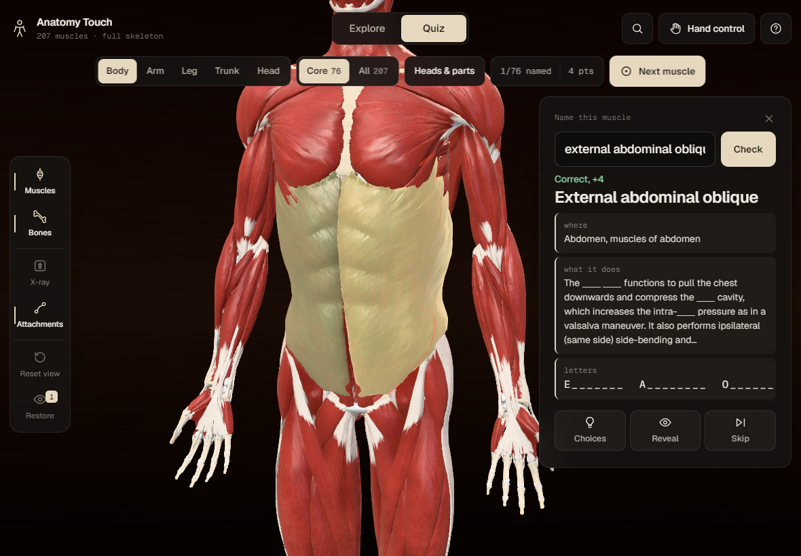

# Anatomy Touch

A touch-first 3D human anatomy atlas built for iPad and other tablets. Rotate, pinch and poke more than 450 real muscles and the full skeleton, peel layers away, and quiz yourself on muscle names.

| Explore | Muscle detail | Skeleton | Quiz |
|---|---|---|---|
|  |  |  |  |

## Features

- **Real anatomy.** Meshes come from Z-Anatomy and BodyParts3D, which were reconstructed from human imaging data. The model has 207 skeletal muscles on each side, 49 of them split into heads or parts (464 muscle meshes in total), plus tendons. Some meshes hold a whole set of small muscles, such as the 11 external intercostals or the 4 lumbricals. The skeleton is complete, with cartilage, intervertebral discs and teeth.
- **Realistic tissue shading.**
  - Fibre striations run along each muscle's line of pull, computed from where its tendons are.
  - Tendons are pearly white.
  - Muscle surfaces have a wet clearcoat sheen.
  - Bone is porous ivory, and articular cartilage is bluish.
  - Ambient occlusion (N8AO) adds soft shadowing in the gaps between muscles.
- **Soft-tissue physics.**
  - Press a muscle and it dents under your finger.
  - Let go and it springs back past rest, jiggles and sends a ripple across the belly, while the tendons stay anchored.
  - *Contract* makes the belly bulge.
  - Bones give a short rigid knock instead.
- **Layers.**
  - Toggle *Muscles* and *Bones* independently, or show both.
  - *X-ray* ghosts the muscles so the skeleton shows through.
  - *Peel away* removes one muscle to expose the deeper layer.
  - *Isolate* shows only the selected structure.
  - *Attach* shows each muscle's origin (red) and insertion (blue) on the bones.
- **Each part of a muscle.** Heads and parts are separate structures, for example the long and short heads of biceps, the three parts of deltoid and of trapezius, and both heads of gastrocnemius. Each one is shown under its muscle, e.g. **Deltoid** with *Acromial part · middle fibres* underneath. The quiz asks for whole muscles by default, and *Heads & parts* switches to naming each head.
- **Quiz mode.**
  - Tap any muscle, or press *Next muscle*, and type its name.
  - Matching forgives typos, ignores left and right, and accepts common synonyms such as "peroneus longus" or "upper trapezius".
  - Naming the whole muscle instead of the head counts as "close".
  - Four levels of hints cost points: region, redacted function, letter pattern, then multiple choice.
  - You can limit the quiz by region, and choose between 76 core muscles and all 207. Progress is saved on the device.
  - If the target is a deep muscle, the overlying muscles are peeled away automatically so you can see it.
- **Gestures.**
  - Touch: one finger rotates, pinch zooms, two fingers pan, tap selects and pokes, hold presses in, double-tap flies to the structure.
  - **Gesture mode** uses the front camera with MediaPipe hand tracking: an open palm rotates, a pinch taps or squeezes, a fist zooms, and pinching with two hands zooms. Video stays on the device.
- **Built for iPad.** Large touch targets, safe-area insets and no page zoom. It runs full screen when added to the Home Screen. The renderer only draws when something changes, which saves battery, and it switches to a lighter mode if frames slow down.
- **Search.** Look up any of the 450+ structures and jump to it. Each structure has a description adapted from Wikipedia.

## Coverage

The adult body has roughly 600 skeletal muscles. This model covers every muscle usually taught in limb, trunk, head and neck anatomy. It's missing some tiny or deep groups that BodyParts3D never modelled: the middle-ear muscles (stapedius, tensor tympani), the auricular muscles, tensor and levator veli palatini, the intrinsic tongue muscles, styloglossus and palatoglossus, the perineal muscles (bulbospongiosus, ischiocavernosus, transverse perineals), palmaris brevis, psoas minor, the subcostales, cremaster, depressor supercilii and articularis genus.

## Development

```bash
npm install
npm run dev        # http://localhost:5260
npm run build      # type-check + production build
```

### Rebuilding the 3D assets

The compressed models in `public/models/` and the metadata in `src/data/` are generated from the Z-Anatomy FBX exports. Put `MuscularSystem100.fbx`, `SkeletalSystem100.fbx` and `Joints100.fbx` from [Z-Anatomy `Resources/Models/FBX`](https://github.com/LluisV/Z-Anatomy/tree/PC-Version/Resources/Models/FBX) in `raw/fbx/`. Also put the list of description file names in `raw/desc_files.txt`. Then run:

```bash
npm run build:model
```

The pipeline (`scripts/build-model.mjs`) does the following:

1. Classifies the tissues from their FBX materials.
2. Bakes the world transforms and normalises the body to 1.75 m.
3. Welds the meshes and decimates them with meshoptimizer (2.75M → 1.6M triangles).
4. Computes per-vertex tissue (tendon or cartilage) and fibre-direction attributes.
5. Writes glTF with quantisation and meshopt compression, about 12 MB for muscles and bones combined.

## Credits and licence

- 3D models: **Z-Anatomy, the libre 3D atlas of anatomy**, CC BY-SA 4.0 (Gauthier Kervyn, Marcin Zielinski, Lluis Vinent).
- Original models: **BodyParts3D**, © The Database Center for Life Science, CC BY-SA 2.1 Japan / CC BY 4.0.
- Descriptions are adapted from **Wikipedia**, CC BY-SA, through the Z-Anatomy definitions.
- Hand tracking: Google **MediaPipe**, Apache 2.0.

Because the models are share-alike, this project, including the code and generated assets, is released under **[CC BY-SA 4.0](https://creativecommons.org/licenses/by-sa/4.0/)**.
